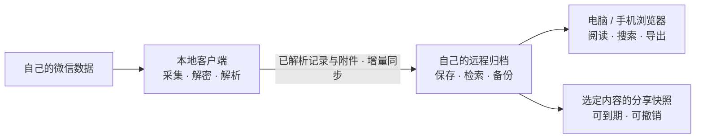

<div align="center">


# 聊记 · Liaoji

### 让重要的对话，随时找得到。

把电脑上的聊天记录，变成自己的可搜索档案。<br />在自己的服务器保存，在浏览器里重读，把想分享的部分单独留下。

[](#快速开始) [](#选择运行时) [](SOURCE-LICENSE.txt)

[为什么用聊记](#为什么用聊记) · [功能亮点](#功能亮点) · [快速开始](#快速开始) · [构建指南](BUILD.md)

</div>

---

## 为什么用聊记

一段值得回看的讨论、一张当时随手发出的照片、一句多年后还想找到的话。

**聊天记录的价值，往往在聊完之后。** 聊记把已在本地整理好的记录接到你自己的归档服务上，让它们可以被查找、阅读、导出和分享。

- **找回一句话**：用关键词和筛选缩小范围，再回到会话里读上下文。
- **换个设备继续看**：电脑负责采集与同步，手机和其他电脑通过远程网页访问已归档内容。
- **留下一段完整讨论**：按范围导出，或制作可撤销的分享链接。
- **把历史留在自己手里**：自己选择服务器、对象存储和备份位置。

> 本仓库是聊记的**远程端**，接收本地端同步的已解析记录。它不能单独读取或解密微信数据库；首次建立档案需要配合本地客户端。

## 功能亮点

以下完整网页能力以 **Python 自托管 + SQLite** 为准；Workers 的范围见[运行时对照](#选择运行时)。

| 🔎 从关键词找到上下文 | 💬 像读聊天一样重温历史 |
| --- | --- |
| 中文检索与会话、日期等筛选，帮助你从一段模糊的记忆回到具体记录。 | 按会话浏览文字与已同步的图片、语音、视频、文件，保留阅读时的上下文。 |
| **🔗 分享选中的片段** | **📦 导出一份可带走的记录** |
| 生成独立分享快照，预览脱敏结果，设置有效期或撤销链接；公开分享支持 HTML / Markdown 读取。 | 选择会话、时间范围和媒体类型，生成 HTML 导出；也可查看归档统计。 |
| **🛡️ 管好访问与设备** | **🗄️ 为长期保存做准备** |
| 浏览器登录与设备同步分开授权，支持 TOTP 两步验证和设备撤销。 | 管理 S3 兼容附件存储与定期备份，让聊天归档有独立于原设备的保存位置。 |

媒体浏览取决于本地解析和附件同步是否完成；语音播放不等于自动转写。备份仍需按自己的环境验证恢复流程。

## 一台电脑归档，多个设备阅读



**原始微信数据的解析留在本地。** 远程保存已解析档案；本地状态变化不会通过同步触发远程删除。分享只读取选定内容的快照，每个链接都有独立的访问边界。

## 快速开始

### 1. 准备环境

自托管源码构建需要 **Python 3.12+、uv、Git、Node.js 22.13+、Corepack**，以及 Linux Docker / Buildx。Windows 可用 Docker Desktop 的 Linux 容器。

建议使用 Node.js 24 LTS；pnpm 版本由仓库的 `packageManager` 固定。构建过程需要联网下载依赖。

### 2. 拉取并构建

```sh
git clone https://github.com/LonglongLab/liaoji.git
cd liaoji
python build.py --verify-only
python build.py
```

第一条 Python 命令核对源码清单；第二条构建远程网页与本机 Docker 镜像。**构建不会自动部署或上传镜像。**

### 3. 配置自己的服务

在 `chat-archive/deploy/self-hosted-distribution/` 中，把 `configuration.example` 复制为 `.env`，填写自己的域名、端口等配置，并将两条第一方镜像引用设为刚构建的本机标签。

接着按 [BUILD.md 的自构建部署步骤](BUILD.md)启动服务、获取首次设置令牌并打开自己的 HTTPS 站点。源码自构建使用 Compose 模板；`install.sh` 下载官方发行镜像的流程不适用于这一步。

### 4. 连接电脑，开始归档

在网页中设置登录口令、按需启用两步验证，配置附件存储与备份，再将本地客户端配对到自己的服务。首批同步完成后，即可从远程网页阅读与搜索。

首次设置令牌和配对材料只交给自己的设备。服务器接收的档案包含可读的聊天内容，部署在你信任和管理的环境中。

## 选择运行时

**想使用完整的聊天档案网页，先选 Python 自托管 + SQLite。** Workers 是另一套范围较小的远程实现，不能直接替换完整自托管站点。

| 能力 | Python 自托管 + SQLite | Cloudflare Workers + D1 / R2 |
| --- | --- | --- |
| 接收同步 | 当前富记录模型 | 冻结的 v1 记录模型 |
| 元数据 / 附件 | SQLite / S3 兼容对象存储 | D1 / R2 |
| 浏览器登录与站点设置 | 支持 | 不提供同等网页流程 |
| 中文索引搜索、统计与 HTML 导出 | 支持 | 不提供同等能力 |
| 分享快照与 HTML / Markdown 直读 | 支持 | 不支持 |
| 服务器定期备份与长任务 | 支持，需配置 | 不支持同等流程 |
| 微信数据库解密 / 本地采集 | 无 | 无 |

Python 的 PostgreSQL 存储分支也保留在源码中，但其记录模型停留在 v1，不等同于上述 SQLite 完整体验。客户端按服务端实际声明的能力启用功能。

## 给开发者

| 路径 | 内容 |
| --- | --- |
| `chat-archive/backend/src/chat_archive/server/` | Python 自托管 API、认证、分享与后台任务 |
| `chat-archive/remote/` | Workers 实现、D1 迁移与 R2 存储接入 |
| `chat-archive/frontend/` | Vue 3 + TypeScript 远程网页 |
| `chat-archive/contracts/openapi.yaml` | OpenAPI 接口契约 |
| `chat-archive/deploy/self-hosted-distribution/` | Docker / Compose 自托管模板 |
| `source-release.json` | 来源快照与逐文件 SHA-256 |

<details>
<summary>只检查或构建某一部分</summary>

在仓库根目录执行：

```sh
python build.py --frontend-only
python build.py --backend-only
python build.py --workers
```

分别构建网页、Python wheel，或执行 Workers 类型检查与 Wrangler dry-run。最后一条不会部署云资源；真实使用前需要配置自己的 D1、R2、迁移和设备认证。

修改源码后，先审阅差异，再用 `python build.py --allow-modified` 构建。此源码导出不附带原 monorepo 的测试、开发环境或 Git 历史，完整构建说明见 [BUILD.md](BUILD.md)。

</details>

## 常见问题

<details>
<summary>只部署这个仓库，就能导入微信历史吗？</summary>

不能。微信采集、数据库解密、原始消息解析和媒体解码在本地客户端进行。远程端只接收整理后的领域记录与附件，不包含这些本地实现或其运行依赖。

</details>

<details>
<summary>聊天内容会传到谁那里？这是端到端加密吗？</summary>

同步目标是你配对的服务器及其配置的对象存储。服务端需要读取已解析内容来提供检索和网页阅读，因此这里不声称端到端加密；服务器、存储和备份的访问权限都需要由部署者管理。项目保留登录、TOTP、备份及存储凭据保护所需的通用加密。

</details>

<details>
<summary>撤销分享后，对方已经保存的内容会消失吗？</summary>

撤销会停止链接后续访问，但不能收回对方已下载、复制或截图的内容。发布前请检查分享范围与脱敏预览；分享链接本身也属于访问凭证。

</details>

## 反馈与参与

欢迎通过 [Issues](https://github.com/LonglongLab/liaoji/issues) 描述问题或提出想法。复现材料请用合成数据，并附版本、运行时和操作步骤；不要上传真实聊天、联系人、数据库、日志原件或访问令牌。

如果聊记对你有帮助，欢迎点一颗 ⭐，也欢迎告诉我们：你最想找回怎样的一段对话？

## 授权

本仓库公开可见，第一方源码适用 [源码自构建使用授权](SOURCE-LICENSE.txt)：允许审阅、研究、修改并在自己的设备或服务器上构建运行；**未采用 OSI 开源许可证，未授予向第三方再分发或转许可的权限。** 第三方代码、依赖和资源保留各自许可证，见 `chat-archive/third_party/`。

请仅处理自己的数据或已获得合法授权的数据；本项目与微信 / 腾讯无隶属关系。
